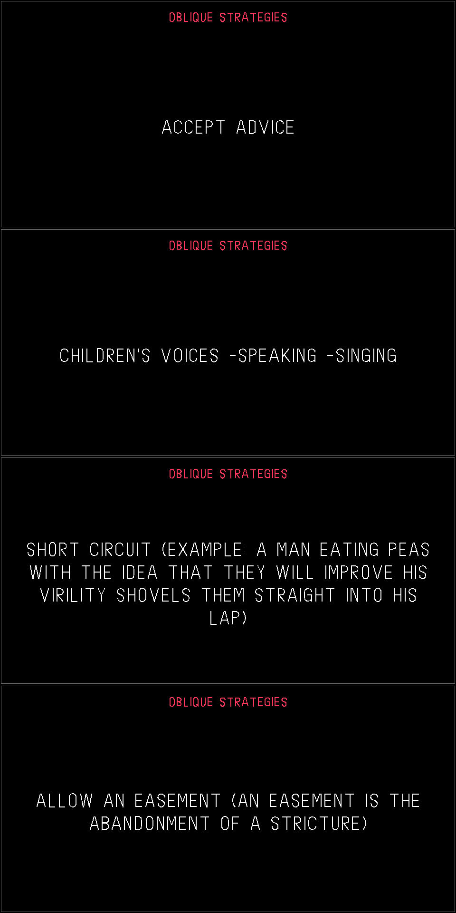

# Oblique Strategies for the OP-1 (original)

**Shift + press the orange encoder** shows a random card from Brian Eno and Peter Schmidt's
*Oblique Strategies* on top of whatever screen you are on. **Any key** closes it; that key press
is swallowed and does nothing else.



Firmware **R246** only. Tested on hardware. The card is drawn in the OP-1's own font, which is converted from the
stock `opfont.svg` at build time.

This repository contains no Teenage Engineering firmware or assets. You provide the original
`op1_246.op1` from https://teenage.engineering/downloads/op-1/original. The build reads the font from it,
and the patcher adds our code to it.

## Use

Requirements: Python 3 (standard library only), plus `bfin-elf` binutils and GCC on PATH. Tested with
binutils 2.42 and GCC 13.3.0.

```sh
bash build.sh op1_246.op1                                   # -> build/obl.bin, build/obl.sym
python3 patch_oblique.py op1_246.op1 -o op1_246-oblique.op1 # stock R246 only (SHA-256 checked)
python3 patch_oblique.py op1r.op1 --allow-modded            # on top of an op1r build: chains to op1r's key hook
```

To install, hold **COM** while switching on, choose firmware update, and copy the `.op1` file over. To go
back, flash the original `op1_246.op1` the same way. The bootloader (`te-boot.ldr`) is never modified.
The patcher refuses unknown input and verifies its output by unpacking it again.

Expected output for stock R246: `sha256 e452aa9576ec8af500442d95bc373eaf2ed9a3634cf5c972c73908067a7ed1db`.

**Use at your own risk.**

## How it works

The patch does two things. It adds one 8 KB LDR block, loaded at `0x01E40000`, just before the FINAL block, and
it redirects two `CALL`s into that block.

| What | Stock R246 address | Notes |
|---|---|---|
| Key hook | `CALL` at `0x019C2D3E` | Input loop (`0x019C2CC0`) → `key_handler(keycode, pressed)` at `0x019B6C74`. **op1r redirects this same call.** |
| Frame hook | `CALL` at `0x01A3BC0E` | End of the GUI frame function `0x01A3BB20`, after every active screen has drawn; the original target is `0x019D7ED0`. Not used by op1r. |
| Shift held | `0x019D7C6C()` | Returns the byte at `0x01DD7F78`. |
| Raster | `0x01A3B490()` | Returns the global rasterizer (`Screen.cpp` `s_raster`). |
| Line drawing | `0x01A24A4C(raster, const pt*, const pt*, int width, const u8 rgba[4])` | Points are in screen px (320×160) as 10-bit fixed point (`px << 10`). Width `0x400` = 1 px. Colours are `{r, g, b, a}`. |
| Encoder push switches | keycodes 59–62 (blue, green, white, orange) | Read by the encoder handler at `0xFFA04A44` (L1). CTRL-mode MIDI CC = keycode + 5, so CC 64–67. |
| Key event queue | `0x01DD5044` | u16 entries `(pressed << 8) \| keycode`; read index `0x01DD5244`, write index `0x01DD5248`. |

`obl_key` and `obl_frame` end by jumping through `obl_next_key` and `obl_next_frame`. The patcher fills these
in with whatever the hooked `CALL`s pointed at before: the stock functions, or another mod's hook. That makes
the mod chainable.

Files:
- **`oblique.c`**: key handling and drawing, about 150 lines of freestanding C, with no libgcc calls.
- **`gen_data.py` and `svgfont.py`**: turn `opfont.svg` and `cards.txt` into stroke and layout tables. Lines are
  pre-wrapped and centred. `'` and `( )` are hand-drawn because the font doesn't have them. `preview.py` renders a PNG.
- **`patch_oblique.py`**: LDR insertion, CALL patching and repacking (CRC32 + LZMA "alone" + tar, using
  op1repacker's LZMA settings).
- **`tools/`**: LDR parser, image builder and RE helpers; see MODDING.md.

## Make your own mods

See **[MODDING.md](MODDING.md)**. It covers the toolchain (binutils, GCC, Ghidra), the firmware format, the memory map, the calling convention, the input and rendering internals with addresses, debugging, and a step-by-step workflow, and it's written so a coding agent can follow it. The helper scripts are in `tools/`.

## For op1r / other firmware builders

This is pure UI. It uses no engine or effect ids, makes no database changes, adds no SVG files, and keeps
about 80 bytes of state. To include it in a build:

1. **Code:** compile `oblique.c` together with the generated `obl_data.c` into your own code block. The fixed
   address `0x01E40000` only matters for the standalone patcher.
2. **Key hook:** if your build already hooks `0x019C2D3E`, call `obl_key(key, state)` first from your handler
   instead of adding a second hook. It returns without forwarding when it consumes the event. Set
   `obl_next_key` to your own continuation.
3. **Frame hook:** patch `0x01A3BC0E` to `obl_frame`, or call it from your own end-of-frame hook. Drawing there
   lands on top of every screen, which is useful for any overlay.
4. **Combo:** Shift + orange push. Check this against your own use of red/orange encoder presses. op1r uses
   Shift + red to start/stop all slots on its sequencer screens. You may want another combo, or to skip the
   card on those screens.

## Credits

- **Card texts:** *Oblique Strategies* by Brian Eno and Peter Schmidt. They are not covered by the licence below.
- **Groundwork:**
  - the op-forums [custom firmware thread](https://op-forums.com/t/custom-firmware-on-the-op-1/4283)
  - [op1repacker](https://github.com/op1hacks/op1repacker)
  - [ghidra-blackfin](https://github.com/sualk/ghidra-blackfin) and [op1-decryptor](https://github.com/sualk/op1-decryptor)
  - [op1dumps](https://github.com/Tolsi/op1dumps)
  - [op1r](https://github.com/pcppcp/op1r), whose patch sites pointed the way
- **Independent project:** not affiliated with Teenage Engineering.

Code: MIT, see [LICENSE](LICENSE).
